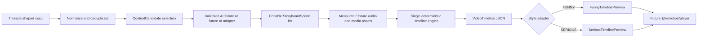

# Editable video pipeline contract

This package is an offline foundation. It does not scrape Threads, call an AI
provider, synthesize speech, connect to a database, render MP4, or publish.

## Contract boundary

The backend owns normalization, content selection, storyboard editing, asset
validation, and the final timeline. Audio duration must come from measured
metadata, a deterministic fixture, or an explicit manual value. Text length is
never a timing source.

Remotion receives a serialized `VideoPreviewProps`. It renders the absolute
`startFrame`, `endFrame`, and `durationInFrames` values from `VideoTimeline` and
must not add its own intro, outro, padding, or minimum scene duration.

The legacy workflows still construct template-specific props and sometimes add
padding inside both backend and Remotion. They remain untouched and dormant.
The target contract isolates that behavior behind `createRemotionPreviewRequest`
until a separately approved migration replaces legacy props.
