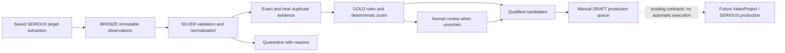
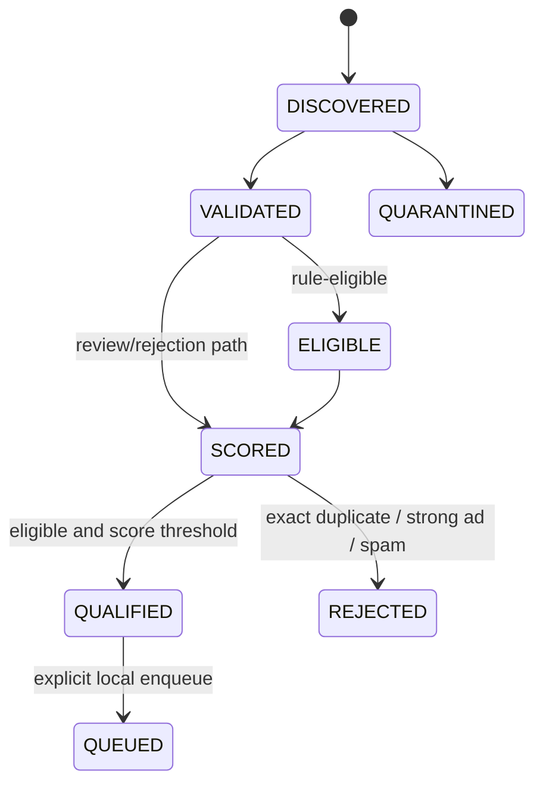

# DATA-01 — Threads SERIOUS data foundation

## Existing source of truth and scope

Studio stores sessions, immutable original text, edits, source attempts, field
availability/provenance, revisions, audio and render manifests under ignored
`1_nest_backend/.studio-data/`. `StudioService.load` is the read boundary;
`persist` uses local JSON and `atomic-file.ts` uses rename/retry. Raw extractor
records are `PublicRecord`; source attempts record canonical URLs, matched IDs,
fetch timestamps, candidates and diagnostics. `public-threads.ts` handles exact
target extraction; the legacy `ScraperService` exposes broader browser scraping.
DATA-01 invokes neither scraper.

The Prisma schema describes legacy PostgreSQL/pgvector `ThreadPost`/`AiAuditLog`;
it is not Studio's session store. `AppModule` imports only `StudioModule`, keeping
operational workflow modules dormant. Legacy `threads-serious` phases use Prisma,
scraping/AI and media/render services. Drama/FUNNY, compilation and lyrics modules
are retained without additions or activation. New production development is
SERIOUS only. No database migration, new database, dependency or infrastructure
service is required.

Before: saved extraction → Studio Source/Script/Voice → Editor timeline → DRAFT MP4.
After: an explicit read-only projection of saved targets also feeds:

The namespace `.studio-data/data-engine/` extends the current JSON/manifest
storage, rather than duplicating sessions/assets or adding a parallel database.
Source sessions are never written by DATA-01. No LLM/agent/browser/model/network
is needed. Publishing remains blocked and rights remain UNKNOWN.

## Versioned contracts

| Layer | Contract and evidence |
|---|---|
| Bronze | `threads-data/1`; external Threads ID parsed from saved canonical permalink (not Studio UUID); original body/author/topic/date; nullable engagement; actual fetchedAt/query; canonical-JSON raw payload SHA256; capture provenance; rights UNKNOWN |
| Silver | Stable ID and bronzeId; normalized body/topic and origin of body mapping; validation status/reasons; inferred heuristic language explicitly separated from source fields; content fingerprint; exact/near duplicate snapshot reference; processing version |
| Gold | silverId; effective eligibility plus original rule labels/reasons; score and weighted breakdown; pinned asOf/config version; selection reasons; queue state |
| Evaluation | Input/config hashes; revision; durable transitions; separate human review and confirmed target type; DRAFT-only queue snapshot |
| Run | Dataset/config identity; bounded immutable inputs; cursor/results; start/completion/error; wall elapsed and sampled active CPU/RSS metrics |

Only a VERIFIED, source-URL-matched existing topic/body mapping can separate a
header topic from old text. Raw text remains unchanged. Display/spoken text and
TTS approvals are not data ingestion inputs. UNKNOWN target type is never silently
converted to POST using the Studio UUID/reference hint. A user must confirm the
entity type before accepting such a target for production.

Missing metadata remains null, not zero. Invalid IDs/URLs/dates, empty source,
invalid engagement, unsupported structures/language and oversize bodies are
quarantined. Unknown language/type/date create review flags instead of fabricated
certainty. Vietnamese language detection is a declared lexical heuristic.

## Deduplication and observations

- Identity is platform + case-sensitive external sourcePostId. Repeated collection
  adds immutable observations, not new posts. Reimporting identical canonical
  inputs/config reuses the completed run and checkpoints.
- Exact content key is NFC + Vietnamese lowercase + collapsed whitespace. Accent,
  wording, punctuation, numbers and slang are not rewritten. Different source IDs
  remain separate posts, linked as duplicates rather than merged/deleted.
- Near duplicate uses token trigram Jaccard, threshold 0.85, minimum 12 tokens.
  It marks NEEDS_REVIEW and retains the similarity and referenced snapshot. Shared
  topic words alone are insufficient. Semantic paraphrase detection is not claimed.
- Existing validated snapshots provide keeper references. Exact-reference chains
  are flattened; self references are excluded when engagement changes. Historical
  duplicate references remain pinned to their original bronze/evaluation snapshot.
- Out-of-order dated observations cannot replace newer source observations. Each
  observation still gets its own validation/evaluation. Equal source times use
  ingestion time then hash as a deterministic tie-break, not a claim of recency.

## Rules and score V1

`config.ts` contains policy version, thresholds, topic/intent vocabulary and weights:
topic relevance 25, context completeness 20, discussion potential 15, video
suitability 15, freshness 10, engagement 15. Qualification threshold is 65 points;
this is experimental and does not mean 65% measured quality.

Commercial classification requires combined intent/CTA/offer signals. Work,
company, salary, hiring or TOEIC terms alone are not advertisements. Personal
narratives quoting advertisements and ambiguous commercial signals require review.
Risk keywords request human review; they do not establish a policy violation.
Quarantined and rejected source is retained. Human review is reversible before
queueing and cannot override structural quarantine or mutate raw source.

Every score component records its signal, weight, contribution and reason. Missing
engagement supplies no score signal; it is not rewritten as observed zero. Freshness
uses the persisted asOf, never a changing wall clock during retry. Precision@10
requires ten distinct ranked items and an explicit true/false label for each;
missing labels return NOT_MEASURED, not assumed negatives.

## State machine and recovery

Each processing state can fail into FAILED with a resumeFrom checkpoint. Explicit
resume records a recovery transition and continues from the last durable state.
SCORED may remain waiting for review or below threshold. Human ACCEPT/REJECT/NEEDS
REVIEW adds its own audited decision; accepting below threshold is an explicit
manual qualification override while the deterministic score remains unchanged.

Files are fsynced and replaced atomically using Studio's existing rename helper.
Bronze raw/input hashes are checked on read; altered source fails closed. Historical
evaluations remain referenced and inspectable. Checkpoints are atomic per file;
replay repairs an interrupted multi-file sequence idempotently. This is a single
backend writer design, not a multi-process transaction database or a guarantee
against disk/power failure. Do not run an independent writer against the same root.
Copy the complete namespace for a consistent backup while no import is active.

## Production boundary

Enqueue is manual, uses an optimistic evaluation revision, retains a pinned
snapshot, sets DRAFT_ONLY/UNKNOWN and starts no worker. The adapter reuses existing
`ContentSource`/`ContentCandidate` contracts with style SERIOUS. DATA-01 does not
create/edit an existing VideoProject, synthesize audio, render, approve content or
publish. Queue claiming, consumption and superseded-snapshot reconciliation are
DATA-02 work.

## Validation milestones

Core offline unit/file integration: 31 tests pass, including fault injection after
a durable score, restart with a new engine, concurrent/idempotent imports, source
integrity, observation history and explicit DRAFT queue contracts. All synthetic
records are marked TEST DATA; they are not represented as real Threads samples.
Final real-session/API/regression measurements are recorded separately after the
Studio integration milestone. No labelled real quality accuracy is claimed.
