# DATA-02B — Legacy Threads crawler recovery

Verified 2026-11-03, Asia/Saigon. Backend only; no Antigravity/frontend changes.

## Historical audit: source capability versus runtime proof

The repository did contain a crawler before recovery. That is confirmed by Git;
it was not a capability invented by DATA-02. What cannot be reconstructed from
committed code alone is the user's historical successful cron execution count.

| Component | Source behavior / evidence | Runtime qualification |
|---|---|---|
| SERIOUS Hunter | `hunter-serious.service.ts:20`: `@Cron('0 */15 * * * *')`, every 15 minutes at second zero | Cron declaration exists; past actual firing/success has no retained evidence inspected here |
| Keyword discovery | `huntWithAiKeywords`: three AI keywords via `generateScoutJson`; fallback `bài học cuộc sống`, `áp lực đồng trang lứa`, `chuyện đi làm`; `/search?q=...` | Requires scraper + AI provider chain; not reactivated |
| Generic Hunter | `hunter.service.ts`: keyword strategy plus `scrapeForYouFeed(4)` | No Cron decorator or tracked caller of `startHunting`; log text about ten minutes is not a timer |
| Scraper | Anonymous Puppeteer; pressable-container DOM, scroll and permalink extraction | Browser primitive reused in the new bounded LIVE pilot |
| Old persistence | Prisma `ThreadPost`, source URL lookup, 768-dimension embedding, pgvector SQL similarity >0.85, AI score >=7 before insert; category SERIOUS | PostgreSQL + vector extension + AI required; old DB not queried or migrated |
| Discord | On module init logs in using configured bot token; review button invokes SERIOUS phase 1; manual `p/!p` URL commands and subsequent phase buttons | Source confirmed; bot not started or contacted |
| Watcher | On module init watches storage folders; `.txt` URL requests invoke DRAMA and delete request files | A folder trigger, NOT SERIOUS keyword discovery; intentionally not activated |
| SERIOUS workflow | `phase1_CreateScript` fetches supplied URLs then AI/script/database; later voice/render stages | Downstream production workflow, not needed for collection-to-review |

Historical wiring:

- `88fbcbd05`: root has `ScheduleModule.forRoot()` but no AutoHunter module import;
  the two Hunter service files exist, while no auto-hunter module file is present
  in that tree. A cron method without a registered provider is not a running job.
- Preservation commit `21db111`: AutoHunterModule exists/imported in source, but
  its entry in the root imports array is commented out.
- Recovery commit `837bbf4`: removes ScheduleModule, Watcher, Prisma, Discord,
  TTS/Uploader/workflow imports from bootstrap to prevent startup side effects.
- Current root imports StudioModule only. Legacy Hunter classes remain preserved,
  not instantiated. No tracked startup script calls `startHunting`.

These snapshots do not disprove that an earlier local/uncommitted setup ran on a
schedule. They establish the wiring that is actually recoverable from Git. No
past LIVE cron PASS is inferred from decorators, comments or commit descriptions.
At this audit's start, no project Node/Python crawler process or matching visible
Windows Scheduled Task was found; Studio port 3000 was not responding. This is an
observation of accessible processes/tasks, not proof about every historical host.

Environment presence only: DATABASE_URL, DISCORD_BOT_TOKEN and HUGGINGFACE_API_KEY
were present; DISCORD_REVIEW_CHANNEL_ID absent (old code can use its channel
fallback). Values were not printed. Installed Prisma/AI dependencies are not
proof of a working database connection or provider credit. Neither was tested.

## Why the old path was not automatically restored

Recovery intentionally disabled operational modules. DATA-02 was implemented
under the then-current official-API-only scope; browser output had not been
adapted into DATA-01. This did not mean a browser crawler never existed.

Blindly enabling AutoHunterModule would also instantiate AI, PostgreSQL and
Discord dependencies. The old data path additionally has confirmed code issues:

- `scrapeThreadsUrl` removes everything after `?`, dropping keyword `q`.
- Its payload has no stable per-post permalink. SERIOUS Hunter can fall back to
  the search URL as `threadId`, confusing source identity with query identity.
- Text-prefix dedup (first 40 characters) can merge different items.
- The old parser supplies a placeholder avatar and a `Vừa xong` time when missing.
- Positional counts and first-container post selection do not establish exact
  target/reply identity. Several exceptions are silently swallowed.
- Old ThreadPost `createdAt` is database insertion time, not source publishedAt.

Those dormant methods are retained for history, not used to populate Bronze.
No credentials, database, browser profile or model was reinstalled to make them
appear operational.

## Reconnected path

```mermaid
flowchart LR
  Trigger[Explicit bounded request] --> Legacy[ScraperService.scrapeForYouFeed controlled mode]
  Legacy --> URLs[Public keyword/feed permalink discovery]
  URLs --> Exact[Existing extractPublicThreads TARGET_ONLY]
  Exact --> Capture[Atomic capture checkpoint + integrity hash]
  Capture --> Bronze[DATA-01 Bronze]
  Bronze --> Silver[Validation / dedup Silver]
  Silver --> Gold[Deterministic Gold]
  Gold --> Review[Human review]
  Review -. explicit ACCEPT and enqueue only .-> Production[Existing DATA-03]
  Cron[Legacy 15-minute cadence: inactive] -. approval required .-> Trigger
```



The existing `scrapeForYouFeed` method now accepts optional controlled discovery
settings. Default legacy callers are preserved. Controlled mode supports a
validated search URL with query intact or the public homepage, and returns
permalinks rather than guessing authors/body from neighboring feed containers.
The existing exact-target extractor supplies actual body/metadata afterward.

Reused blocks: (1) legacy browser/discovery lifecycle and selectors, (2) existing
Studio exact extraction, (3) DATA-01 canonical identity/validation, (4) existing
atomic storage/dedup, (5) existing scoring/human review. Added blocks: (6) source
adapter and (7) bounded checkpoint/API runner. That is **5/7 (~71%) by this stated,
unweighted functional-block inventory**, NOT a measured percentage of legacy LOC,
historical runtime coverage or video quality. No trustworthy old-code LOC reuse
percentage was measured. AI, Prisma, Discord and cron activation are not claimed
as restored LIVE components.

No Hunter/Discord/Prisma/workflow module is imported for this bridge. Bronze keeps
exact text/raw record, canonical shortcode, URL, author/avatar, observed date,
topic, counts and source evidence. Missing metadata stays null; zero remains zero.
Discovery keyword/mode lives in the run input; each Bronze links that run via
collectionRunId, plus its exact fetch URL and identity evidence. Context candidates
remain in the captured attempt, not in Bronze/Gold as additional selected posts.
All new observations require manual review and keep rights UNKNOWN.

## Operational API and resource bounds

Base: `/api/studio/data/crawler`, existing local backend/envelope.

| Method/path | Purpose |
|---|---|
| `POST /runs` | Explicit SEARCH, FEED or supplied URLS pilot |
| `GET /runs` | Run list and persisted status |
| `GET /runs/:id` | Detailed capture, identity and extraction diagnostics |
| `GET /runs/:id/report` | Actual DATA-01 counts/reasons, not AI-generated summary |
| `POST /runs/:id/resume` | Explicit checkpoint recovery |
| `GET /schedule` | Legacy cadence plus disabled/not-activated status |

```json
{"mode":"SEARCH","keyword":"chuyện đi làm","requestId":"unique-client-UUID"}
```

FEED uses `{"mode":"FEED","requestId":"..."}`. URLS uses
`{"mode":"URLS","urls":["<public Threads permalink>"],"requestId":"..."}`.
At most two URLs, one scroll, existing browser only, anonymous fresh context.
Discovery allows at most four navigations / 200 browser resource requests and
blocks images/media/fonts. HTTPS/domain restrictions apply to requests; no
stealth, account cookie/profile reuse, password entry or CAPTCHA interaction.
Existing installed Edge is now a fallback for the exact extractor as well.

Discovery navigation timeout is 20 seconds in the runner. Exact extraction keeps
its existing finite response/navigation/selector timeouts. The runner stops
starting new uncaptured targets after 180 seconds per explicit execution/resume;
the original run timestamp remains for audit. This is not a promise that an
already in-flight bounded extraction is killed exactly at 180 seconds. One crawl
per consumer; backend HTTP runs share the existing Studio operation mutex. Heavy
operations were run sequentially, no TTS/render or model downloads.

Run/capture checkpoints use existing DataStore under ignored
`.studio-data/data-engine/crawler-runs`; no second database. requestId is
idempotent and conflicting input is rejected. A saved capture resumes offline
before new fetching; DATA-01 import checkpoints/dataset identity prevent duplicate
posts. Raw capture hashes are checked before import. COMPLETED replay does not
fetch again. BLOCKED_ACCESS is not automatically retried. No-public-targets alone
is not asserted to be a permission failure. HTTP 401/403/429 or actual access gates
stop the run. Even valid public metadata fallback is not imported through an
encountered login/challenge gate.

Schedule remains disabled. There is no new timer or Windows startup task. Rebinding
the old cadence to this controlled consumer requires explicit subsequent approval;
do not enable the old Hunter module with its AI/database/Discord side effects.
This pilot demonstrates a programmatically automatic collection cycle, not a LIVE
continuously running cron installation.

## LIVE results

SEARCH run `4c9b4ebcad03e416b6ca3192e8ad949ad396894e2bb9666d3a014c43275a5298`:

| Result | Observation |
|---|---|
| Keyword | chuyện đi làm |
| Discovered / exact-matched / imported | 2 / 2 / 2 |
| New unique posts | 2 |
| Bronze / Silver / Gold observations | 2 / 2 / 2 |
| Quarantine / automatic acceptance / production queue | 0 / 0 / 0 |
| Processing state | SCORED, waiting human review |
| Elapsed | 17,197 ms |
| Exact match | DOM_PERMALINK for both |
| Extraction completeness | PARTIAL for both; entity hierarchy/engagement verification remains limited |

Targets and captured metadata at the pilot observation:

| Target | Source publishedAt (UTC) | Body characters | Likes / replies / reposts / shares |
|---|---|---:|---|
| [songdehanhphuc289](https://www.threads.com/@songdehanhphuc289/post/DeYYOpGknmH) | 2026-10-12 04:30:00 | 228 | 64 / 8 / 2 / 1 |
| [linhtalinhtinh1209](https://www.threads.com/@linhtalinhtinh1209/post/DaiLiWQgaTB) | 2026-07-08 13:45:56 | 246 | 247 / 45 / 10 / 12 |

Both concern workplace communication/social expectations. First topic was `Đi làm`;
second topic unavailable. Counts are stored parser observations, not a claim of
fully verified source fidelity. No count from a context card was intentionally
substituted. New-to-store does not mean newly published today; web search ordering
has no recency guarantee here. Target type stays UNKNOWN until confirmed; a
`/post/` URL is not automatically proof of root post versus reply.

Current deterministic rules flagged NO_CONFIGURED_SERIOUS_TOPIC_MATCH even for
these work-related texts, plus manual discovery review and unknown entity type.
This is a narrow-rule/lexicon limitation to review, not evidence that collection
failed or a reason to fabricate acceptance. No quality percentage or Precision@10
is claimed. Rules were not silently changed in DATA-02B.

Independent fresh fetch of the first target used a second URLS run:
`277b95c68d0925ac520c4c55d9eecb7708c0cea21d9419e4d48df18d404c620d`.
It took **5,179 ms**, added **0 new posts / 1 duplicate-source observation**.
Database totals: **7 unique posts**, from original five plus two new; three new
Bronze/Silver/Gold observations across the two runs. Old snapshots remain intact.
A new process resumed the completed SEARCH run in **1 ms** without browser/network.
Actual interrupted-capture/import recovery is additionally tested with injected
failures in isolated synthetic stores; no live process was killed to simulate it.

## Validation, limits and next steps

- Backend TypeScript/build: PASS, exit 0. Offline Jest: **29 suites / 183 tests PASS**,
  including ten crawler tests for limits, exact identity, raw preservation,
  access gates, idempotency/dedup, capture/import recovery and concurrency.
  Resume after an old interrupted discovery checkpoint receives a fresh bounded
  execution budget without repeating discovery; covered by regression test.
- LIVE browser discovery/extraction/import/dedup: PASS for the bounded runs above.
  Full metadata fidelity: PARTIAL. FEED mode is implemented but not separately
  claimed LIVE-tested by this SEARCH pilot. Historical cron/DB runtime: NOT VERIFIED.
- Original nine session hashes and all 16 original DATA-01 files remained unchanged.
  Existing DATA-02/03 were preserved; no review decision was modified. No render,
  LLM, TTS, Discord, database connection, upload or publishing was started.
- No project worker was active at audit start; Studio is started through its
  guarded local launcher after verification. No unrelated process/worktree is stopped.
- Ignored evidence: `.studio-data/reports/data02b`, crawler runs and immutable
  DATA-01 observations. Browser resource limits are configured bounds, not a claim
  that every HTTP resource was counted in the report. Free RAM was sampled; this
  was not a continuous peak-memory benchmark.

The official Threads API is **not technically required for this successful public
DOM pilot**. It remains available for authorized account operations and future
official discovery if access is granted, and provides a more stable structured
channel than changing web DOM. Public visibility does not establish media reuse
rights, permanent anonymous access or platform approval for unlimited automation.
Do not turn this into a login/permission bypass when the public site denies access.

Next: inspect these two real records in existing DATA-01 review, confirm target
type, adjust rules only with labelled evidence, and decide whether/when to authorize
a bounded scheduled cadence. Nothing is automatically sent to DATA-03 production.
