# DATA-03 — Reviewed Content → Studio VideoProject

Backend API handover for Studio V3 / Antigravity. Existing Studio frontend and
`design/studio-v2` are untouched. No new database, scheduler, crawler, AI agent,
renderer or inference worker is introduced.

Source inventory (relative to `1_nest_backend/src`): new
`data-engine/production-contracts.ts`, `production-adapter.ts`,
`production-consumer.ts`, `production-consumer.spec.ts`; modified
`data-engine/data.controller.ts`, `engine.ts`, `store.ts`,
`studio/studio.service.ts`, `studio.contracts.ts`, `render-policy.ts`, and
`video-pipeline/contracts.ts`. This handover is the twelfth changed source/test/doc
file. Runtime data and screenshots are ignored, not committed.

## Scope and architecture

Before: DATA-01 could review, enqueue and expose `production-input`, but nothing
consumed its queue. Enqueue also allowed heuristic qualification without explicit
ACCEPT. After: enqueue requires ACCEPT, and an explicit production operation
materializes one new SERIOUS Studio session from a pinned queued evaluation.

```mermaid
flowchart LR
  Saved[Saved Threads] --> Bronze[Immutable Bronze]
  Bronze --> Eval[Silver / Gold evaluation]
  Eval --> Human[Human ACCEPT + confirmed target]
  Human --> Queue[Manual DRAFT enqueue]
  Queue --> Job[Production job + pinned snapshot]
  Job --> Session[New Studio session / VideoProject]
  Session --> Script[Script DRAFT / explicit approval]
  Script --> Voice[Existing Voice operations / explicit action]
  Voice --> Editor[Existing Editor and timeline engine]
  Editor --> Render[Existing DRAFT render / explicit action]
  Render -. blocked .-> Publish[Publishing]
```



DATA-03 ends at project preparation. No user content is ACCEPTed by the consumer.
No script/audio approval is inferred from DATA-01 review, asset existence or job
success. Existing Script, Voice, Editor, Preview and Render APIs are reused.

## API conventions

Base: `http://127.0.0.1:3000/api/studio/data`. Responses use the existing
`{ "success": true, "data": ... }` envelope. Mutations permit local Studio origins;
nonlocal browser origins are rejected. No credentials are required in payloads.

| Operation | Method/path relative to base |
|---|---|
| Source detail / current evaluation | `GET /posts/:postId` |
| Human review (existing) | `POST /posts/:postId/review` |
| DRAFT enqueue (existing, now ACCEPT required) | `POST /posts/:postId/enqueue` |
| Production source projection (existing, extended with IDs/revision) | `GET /posts/:postId/production-input` |
| Ready queued content / retry candidates | `GET /production/ready?page=0` |
| Production jobs | `GET /production/jobs` |
| Full snapshot and audit history | `GET /production/jobs/:jobId` |
| Live Script/Voice preparation state | `GET /production/jobs/:jobId/readiness` |
| Create/reuse project from queue | `POST /production/jobs` |
| Explicit retry/recovery | `POST /production/jobs/:jobId/resume` |

Human review uses the existing body:

```json
{"revision":7,"decision":"ACCEPT","reason":"Human review reason","confirmedType":"POST"}
```

Use the returned evaluation revision for enqueue:

```json
{"revision":8}
```

Numbers above are illustrative, NOT fixed revision values. UNKNOWN targets need
an explicit POST/COMMENT confirmation. A contradictory known target is rejected
by the consumer. Quarantine, invalid identity and stale source cannot be bypassed
by ACCEPT. Never call review/enqueue automatically to make the UI proceed.

`production-input` and enqueue now also return `postId`, `evaluationId` and the
new queued evaluation `revision`, in addition to the original queue/source/content
projection. Alternatively use `/production/ready` for these exact current values.

Create-project body (replace placeholders with values from the API):

```json
{
  "postId":"<64 lowercase hex>",
  "evaluationId":"<64 lowercase hex>",
  "queueId":"<64 lowercase hex>",
  "revision":9,
  "requestId":"<client-generated UUID reused on retries>"
}
```

The operation is small and synchronous: it returns a persisted job, normally
SUCCEEDED with stage WAITING_SCRIPT_REVIEW, `projectId` and `studioUrl`. HTTP 201
also applies when POST returns a cached job; it does not mean another project was
created. Unknown request fields are discarded. UUID-like request keys use only
letters, digits and hyphens, 1–100 characters.

Ready rows contain source URL/ID, author, display-text preview, heuristic score,
the three IDs/revision above, and any job link/status. `canCreateProject` is true
only without an existing job; `canResume` identifies interrupted/failed jobs.
SUCCEEDED entries are excluded. Source evaluation remains QUEUED: consumption is
represented by the separate durable job index, not by rewriting the approved
source snapshot. Jobs remain discoverable through the jobs endpoint.

## IDs, revisions and client behavior

- `jobId`: 64-hex hash of post/evaluation/queue identity.
- `projectId`: deterministic UUID reserved from that job identity, also Studio
  session ID; use the returned `studioUrl`, `/studio?session=<projectId>`.
- `revision` in creation: **DATA-01 evaluation revision after enqueue**.
- Session revision in existing Script/Voice/Editor operations: current **Studio
  session revision**, initially 1. Item revisions initially 0 are separate again.
- Keep one requestId per user intent. Double-click/restart reuse it. Different
  requestIds for the same queue still return the same project. Reusing a key for
  another queue/revision fails with IDEMPOTENCY_CONFLICT.
- Retrying creation never silently executes a FAILED job: show its saved error
  and use explicit resume. Stale snapshot recovery requires the user to revisit
  DATA-01 review/current observation; the API never edits approvals to unblock it.
- A completed replay returns the historical project without creating/refreshing
  content or overwriting subsequent manual edits. It is not new approval of a
  later source observation.

Job statuses: QUEUED → RUNNING → SUCCEEDED or FAILED. History carries timestamp,
status, stage and fixed reason. RUNNING stages include VALIDATING_SNAPSHOT and
CREATING_PROJECT. There is no percent/ETA because file materialization is not a
measured long-running inference/render stage. SUCCEEDED means **project creation**,
not completed audio/video or quality approval. Poll jobs lightly while a request
is in flight; after success use readiness plus existing Studio stage jobs.

The old Studio progress panel does not display these pre-session DATA jobs. V3
should render this API's history; once a project exists, continue using the
existing `/api/studio/sessions/:id/jobs` operations for Script/Voice/Editor/Render.
The source queue needs a durable job before a session exists, which is why it
does not pretend to be a session-bound Studio job.

HTTP 409: STALE_REVISION, IDEMPOTENCY_CONFLICT, session collision. Invalid request
and missing/unqualified/unreviewed source fail HTTP 400 before creating a job.
Execution failures return a persisted FAILED job with safe error code (for
example PRODUCTION_SNAPSHOT_MISMATCH, PRODUCTION_CHECKPOINT_INTEGRITY,
PRODUCTION_TARGET_CONFLICT, PRODUCTION_SESSION_COLLISION or
PRODUCTION_MATERIALIZATION_FAILED). No filesystem exception detail is exposed
as a job error. Operators should inspect job history before explicit recovery.

## Persistence, safety and recovery

- Same DATA-01 DataStore / atomic fsync+rename strategy, under ignored
  `.studio-data/data-engine/production-jobs/<jobId>.json`. Schema remains
  `threads-data/1`, with `jobVersion=production-consumer/1`.
- Every job retains immutable-by-contract Bronze/Silver/Gold/review/queue snapshot,
  processing/config versions and snapshot hash. Current source identity, target,
  explicit ACCEPT, eligibility, queue identity and revision are validated again
  before materialization. DATA-01's existing writer lock is held while Studio
  commits the new session, preventing concurrent import/review races.
- Session/project `productionOrigin` contains job/post/queue, Bronze/Silver and
  evaluation IDs, evaluated revision, snapshot hash and DRAFT_ONLY mode. Bronze
  and raw payload remain unchanged; no render media/audio is copied.
- A crash before session write resumes from the pinned snapshot. A crash after
  session write reopens the reserved ID, verifies matching origin and preserves
  any manual edits/locks. Conflicting IDs never overwrite files. No startup
  scanner or automatic retry runs; explicit resume is required.
- Existing single backend writer is required. This does not implement distributed
  process locks or a multi-machine consumer. Bulk scheduling is outside DATA-03.
- Original text and metadata remain source values; display/spoken initial drafts
  use existing verified body mapping. Topic is not heuristically removed from the
  first line. Mapped topic/header remains separate; unknown metadata stays null,
  available zero counts stay zero. Missing comment parent stays unknown, never a
  fabricated parent post. Source media references are preserved, not downloaded.

## Preparation and render boundaries

New projects have a selected content item, initial storyboard scene, editor
settings, raw/original text and editable display/spoken drafts. Default voice is
the existing `my_yen` preset at shared SERIOUS speed 1.2, not a claim of runtime
availability or generated speech. Audio assets, script proposals and approvals
are absent. No AI normalization or TTS is called by creation/resume.

`readiness` reports current matching script approval and audio manifest state;
it explicitly says quality was NOT validated by the consumer. Existing Editor
builds the only authoritative timeline. Without narration, its existing explicit
visual-only preview duration is not a measured audio duration. Rendering remains
blocked on missing narration. Actual voice durations still come from FFprobe.

DATA-03 origin adds a server-side FINAL blocker in existing render validation.
Only DRAFT preparation is supported. Actual DRAFT render still requires explicit
user action, matching audio and resource checks; existing low-RAM concurrency=1
and TTS/render exclusion are retained. No new renderer/MP4 path is introduced.
Rights remain UNKNOWN and Publishing stays locked. Localization of remote avatars
and media, audio generation/approval, final edit review and MP4 validation are
future user-directed stages, not proof implied by project creation.

## Verification

| Check | Result |
|---|---|
| Backend TypeScript | PASS, `tsc --noEmit --incremental false`, exit 0 |
| Backend build | PASS, `npm run build`, exit 0 |
| Complete offline Jest | PASS, 28 suites / 173 tests, exit 0 |
| New DATA-03 unit/integration coverage | PASS, 10 tests |
| Actual browser with isolated synthetic store | PASS: Script opened, text visible, reload/idempotency, zero runtime exceptions |
| Main runtime APIs | PASS: ready/jobs/session/editor/Studio HTTP 200 |
| Existing nine sessions | PASS: all original SHA-256 hashes unchanged; main revision 112 / five selected items |
| Real content production | NOT RUN: main ready count 0, main production-job count 0; no real review altered |
| TTS / MP4 / publication | NOT RUN, explicitly outside this verification |
| V3 frontend integration | NOT IMPLEMENTED: backend handover only, Antigravity worktree untouched |

The browser observed approximately 548 MiB free RAM before launch and 401 MiB
after page load, then closed. A later low-memory sample (~243 MiB) caused a short
pause; memory recovered before final compilation. Final TypeScript/build used a
512 MiB V8 heap cap (not a total process RAM cap). Tests/build/browser were run
sequentially; no OOM observed. No unrelated process was stopped.

Tests use real filesystem persistence in isolated temporary stores and clearly
marked SYNTHETIC TEST DATA, not real content decisions. They cover unaccepted
and unconfirmed sources, stale revision, draft gates, immutable originals,
idempotency across concurrent requests/restart, recovery after project write,
manual edits/locks, session collision, corrupted checkpoint, topic separation,
existing Studio HTTP routes and existing SeriousTimelinePreview contract.

A separate live Edge headless smoke used existing browser/runtime, isolated
loopback Nest API and the unchanged Studio frontend. It created a synthetic
project through the production API, opened Script, displayed original text,
reloaded and checked idempotency. No runtime exceptions. Screenshot and result
JSON are ignored under `.studio-data/reports/data03/smoke-*/`. Browser and isolated
API closed after verification. This is actual browser evidence with SYNTHETIC
content, not live Threads collection or TTS/MP4 proof.

No real source was accepted, queued or consumed during verification. Original
nine sessions must retain their hashes. There is intentionally no new demo
session in the real Studio session list; the synthetic demo store is isolated.
Antigravity integration and a user-selected real ACCEPTed/queued source remain
the next steps. Scheduler stays disabled; no API collection, inference, render,
publishing, dependency installation or model download is needed for DATA-03.
