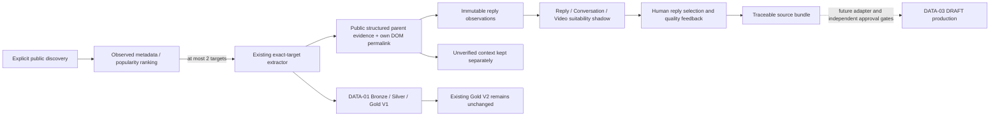

# DATA-04 — Conversation discovery, evidence and shadow quality

## A — Read-only audit (2026-11-05)

Base `35179ea`, dedicated branch/worktree `codex/data04-conversation-quality`.
All three prior worktrees were clean and remain untouched. Production baseline:
933 readable runtime files, no locked files; private manifest hash
`4897b40301b9452182147d1ea35d5c91c9867ffa47701d525f6ef65e890227e8`.

| Existing component | Confirmed source behavior | Reuse / limitation |
|---|---|---|
| `ScraperService.scrapeThreadsUrl:10` | Drops query; scrolls four times; first card becomes post, remainder comments | Do not reuse this parser as verified replies |
| Same file `:117` | Same-author/DOM-order/previous-author heuristics infer replyTo; 40-char prefix dedup; placeholder avatar/time | Unsafe relationship/identity and missing-data inference |
| `scrapeForYouFeed:158` / `public-discovery.ts` | Controlled public navigation, installed browser, URL allowlist, small budgets; returns first permalinks | Reuse lifecycle/budgeting; order is not HOT ranking |
| `extractPublicThreads:355` | Exact target by unique permalink, labelled controls, time and topic evidence | Reuse exact-post extraction; compact counts may be approximate |
| `public-threads.ts:426` | Context stores own URL/text/author, UNKNOWN type and null parent; explicit unverified relationship | Context is persisted in crawler attempts/session, not verified reply Bronze |
| `crawler-consumer.ts` | Exact root import, checkpoint, Gold V1/V2 shadow | No verified reply collector or relationship graph |
| `crawler-adapter.ts` | Preserves identity evidence/raw fields; no parent invention | Reuse post projection |
| Gold V1/V2 | Single-post lexical/content/context/engagement rules | Retain unchanged; no conversation quality or verified reply sample |
| Studio | Global catalog review and on-demand discovery; Gold feedback separate from production | Extend existing panels, not replace them |
| DATA-03 `production-adapter.ts` | One pinned reviewed source → one initial scene | Source bundle must preserve reply identities; no automatic multi-source handoff |

Reply permalink is sometimes observed in context. Parent/nested hierarchy is **not
verified** by current extraction. Visible counts, time elements and labelled
controls are observations; positional numbers, same author, DOM proximity, absent
time defaults and handle-only parent are not evidence of a reply relationship.

The new strict reader may accept an explicit public structured relationship,
never card proximity. Schema.org defines [Comment.parentItem](https://schema.org/parentItem)
and [CreativeWork.comment](https://schema.org/comment) as parent/comment relationships.
This establishes parser semantics, **not that Threads currently exposes them**.
Whether public Threads pages expose sufficient relationship evidence remains a
LIVE pilot question. No Threads page/API was fetched in checkpoint A.

Production remains THREADS SERIOUS. FUNNY/Compilation/Lyrics are not reactivated.

## Checkpoint status

- A: source audit PASS; historical live reply hierarchy NOT VERIFIED.
- B–G: PASS OFFLINE; READY_FOR_LIVE. No LIVE pilot authorized or executed.

Final checkpoint evidence and limitations are below. No LIVE result is claimed.

## B — Popularity foundation

Versioned multi-signal scorer and comparable-evidence ranking are implemented. Missing values stay null; velocity requires two consistent observations. Sparse candidates preserve observed order and report PARTIAL. Synthetic regression: 3 tests PASS. Public observation adapter is completed with collector checkpoint C. No HOT or viral prediction is claimed.

## C — Strict collection adapter

Public structured Comment.parentItem/comment edges plus DOM own permalink form the only accepted relationship evidence. Missing/conflicting/unrelated/cyclic parents remain unverified; nested chains must reach the exact root. Public collection never claims COMPLETE. Disposable installed browser, 30s/page, <=150 requests, <=4 navigations, <=2 scrolls, <=20 verified replies. Lightweight discovery observes at most six unique candidates; ambiguous card counters are not attributed. Compact approximate counts are excluded from ranking. No live request has run. Seven identity/relationship tests PASS; backend TypeScript exit 0.

## D — Reply Quality V1

Conservative Vietnamese lexical rules separate SUBSTANTIVE/LOW_INFORMATION/SPAM/DUPLICATE/UNCERTAIN, preserving all raw text. Short counterarguments can be substantive; employment/TOEIC alone never classify advertising. Exact and Jaccard near duplicates have separate reasons. Sarcasm and semantics remain human-review limitations. Four quality tests PASS (including emoji, short counterargument, personal experience, duplicate and spam).

## E — Persistent conversation shadow and human selection

Atomic DataStore namespaces now retain run checkpoints, immutable collection/reply observations and revisioned feedback. Existing DATA-01/Gold V1/V2 decisions are pinned and untouched; new roots enter DATA-01 as UNKNOWN and unreviewed. Requests are idempotent, restart resumes saved captures, feedback has stale revision checks. Source bundle retains reply identities/evidence but deliberately has productionApproved=false and handoffEnabled=false. No DATA-03 multi-source production adapter is enabled. Twenty-one DATA04 tests PASS; backend typecheck exit 0. LIVE remains disabled unless explicitly approved and enabled in local runtime. Exact-root extraction reuses existing code with optional bounded mode; default callers retain their previous behavior.

## F — Studio integration

Existing Discovery and Data Review now share ConversationPanel: run/ranking overview, exact root, verified-only selection, excluded context, per-reply labels/reasons, sample-only ratios, score breakdowns and revisioned history. Copy Markdown/JSON exports read persisted results. Buttons cannot start LIVE while the approval flag is disabled. No redesign of Antigravity shell, no production approval coupling. Frontend TypeScript and Studio build exit 0. Actual Chrome + Nest/atomic store synthetic E2E: 8/8 PASS. Only the public source provider is synthetic; UI/API/persistence and structured DOM reader execute real code. Browser free RAM samples: 770 MiB before, 661 MiB during, 1008 MiB after. No live crawl performed.

## G — Final verification and handoff

**PASS OFFLINE / READY_FOR_LIVE. PASS LIVE: NOT RUN.**

Existing sources are linked to their current Bronze/evaluation/revision without
updating DATA-01 review, queue or Gold V2. New roots are imported once as
`itemType=UNKNOWN`, `rightsStatus=UNKNOWN`, unreviewed. Reply observations are
separate immutable files in the same atomic DataStore; they are not silently
added to a project. The source bundle is deliberately `productionApproved=false`,
`handoffEnabled=false`: DATA-03 multi-source project generation remains future
work after the independent approval gates are designed and granted.

### Verification evidence

- Backend TypeScript, backend build, frontend TypeScript and Studio esbuild: exit 0.
- Jest offline: **39 suites / 244 tests PASS**, including 23 DATA-04 cases.
- Final Chrome + real Nest/atomic store E2E: **10/10 PASS**. The only source
  substitution is the explicitly synthetic public provider. DOM/JSON-LD reader,
  scoring, imports, HTTP endpoints, review/history and downloads execute actual code.
- Browser verifies ranking, nested replies, exclusion of unrelated context,
  no crawl on opening, selection and individual labels, no automatic approval,
  refresh/reopen, Copy Report/JSON, stale revision 409 and same-author/different-post
  collection switching. No browser exception or backend outbound request observed.
- Additional recovery tests cover interrupted collection persistence and an
  interrupted DATA-01 import, explicit resume, config mismatch, integrity checks,
  double-click, invalid URLs, duplicate requests, stale feedback and preserved Gold V2.
- Browser artifacts remain ignored under backend `.studio-data/reports/data04/`;
  `browser-latest.json` points to the latest unique evidence directory. Each
  browser run uses a new external `Tiktok_Automation_data04_acceptance` sandbox;
  old evidence/sandboxes are retained. No production credentials are copied.
- Production: **933/933 files byte-identical**, no unreadable/locked files.
  Before/after manifest SHA-256:
  `4897b40301b9452182147d1ea35d5c91c9867ffa47701d525f6ef65e890227e8`.
- A synthetic 20-verified-reply CPU microbenchmark (100 iterations, 5 warmups):
  median **1.106 ms**, p95 **1.839 ms**, process RSS **32.8 → 37.6 MiB**.
  This excludes browser, network and persistence; it is not a LIVE throughput claim.
- Final browser RAM samples: **480 MiB before / 511 MiB during / 812 MiB after**.
  An earlier attempt reached **159 MiB available**; no OOM was observed. A Jest
  process was observed at 845 MiB working set; aggregate peak/commit was not measured.
  Builds/tests/browser were run sequentially, no inference or rendering.

Initial browser harness failures were corrected: `about:blank` was an invalid
fixture base URL, headless clipboard needed sanitized-write permission, and POST
201 is a valid Nest response (not a backend failure). Downloads now use a unique
directory and assert the exported run ID, avoiding stale artifact false positives.

### API contract for Studio / agents

Base: `/api/studio/data/conversations`. Same operations are used by the UI.

| Method/path | Behavior |
|---|---|
| GET `/options` | Budgets, scheduler OFF, LIVE approval flag; no browser start |
| GET `/runs` | Persisted run history/checkpoints/results; no collection |
| POST `/runs` | `{requestId, keyword, limit:1..2}` OR `{requestId, urls:[canonical permalink], limit}`; explicit action only |
| GET `/runs/:id` | Durable run/checkpoint and errors |
| POST `/runs/:id/resume` | Explicit resume; uses saved capture/results; no startup retry |
| GET `/collections/:id` | Immutable collection + scores + current human review |
| POST `/collections/:id/feedback` | `{requestId, revision, selectedReplyIds, replyLabels, decision, reason}`; stable verified IDs only |
| GET `/collections/:id/bundle` | Traceable, non-approved source bundle; no project creation |

Feedback `decision`: ACCEPT / REJECT / NEEDS_REVIEW is **quality feedback only**.
`replyLabels` values: SUBSTANTIVE / LOW_INFORMATION / SPAM / DUPLICATE / UNCERTAIN.
Concurrent work, stale revisions and conflicting request IDs return 409. Bad
identity/inputs return 400. LIVE endpoints return 403
`CONVERSATION_LIVE_APPROVAL_REQUIRED` until explicitly enabled after approval.
The production service is always LIVE-mode; only the isolated test harness injects
a SYNTHETIC provider. No request body can switch the production provider to synthetic.

### What the scores mean

- Popularity v1: log-scaled likes/replies/reposts/shares (weights 15/30/15/15),
  freshness 15, reply growth/hour 10 only with two consistent observations.
  The pilot currently has no measured velocity and leaves it missing.
- Ranking requires at least two reliable counters + publication time, and equal
  available metric sets across candidates. Otherwise observed order is retained
  with PARTIAL and a warning, never labelled HOT. Compact approximate counters
  are excluded from comparable ranking; raw source evidence remains retained.
- Reply quality uses lexical relevance, experience/reason markers, context and
  lexical novelty plus duplicate/emoji/spam rules. Job/company/TOEIC alone are
  not advertising. Unknown semantics remain UNCERTAIN.
- Conversation and suitability scores are separate shadows, not probabilities,
  measured accuracy or production approval. Viewpoint diversity and information
  novelty are explicitly lexical/argument proxies, not semantic understanding.
- All ratios describe the **verified observed sample**, not all reported replies.
  Precision@10 remains **NOT_MEASURED**. Existing DATA-01 `precisionAt10` requires
  ten distinct ranked items and explicit binary ground truth for every item;
  synthetic labels or three observed replies do not establish real accuracy.

### Known limits / LIVE gate

Public Schema.org relationship fields are supported, but whether Threads actually
exposes them for the chosen target is **unverified**. A permalink/author/DOM position
alone never verifies parentage. If structured relationship evidence is missing,
the real target may be collected but replies remain unverified and status is
UNKNOWN/PARTIAL; this is not PASS LIVE. Parent cycles/conflicts, missing visible
permalinks and wrong-root chains fail closed. The collector never emits COMPLETE.
No follower count, impressions, view count or engagement rate is fabricated.
No external media/avatar enrichment is added in DATA-04.

The exact-root controlled adapter reuses the existing extractor with at most
three public HTML fetches, 8s socket/absolute response time, installed browser
only and a 20s browser deadline. Reply/discovery visits have a 30s browser deadline,
<=150 allowed requests, <=4 main navigations, <=2 scrolls (discovery <=1).
Each browser launch also has Puppeteer's default launch timeout; only one browser
exists at a time. Two browser visits per enriched root are sequential. Budgets
are per explicit attempt; failed runs do not retry automatically. DNS and response
limits apply to controlled HTML reads. No credentials, login or CAPTCHA bypass.

**GO for one approved LIVE pilot, not for unattended collection or production.**
Before that pilot:

1. User approves one existing canonical public target and a single bounded run.
2. Check RAM, no Kokoro/render/browser worker running; use an isolated store with
   no production credentials. Do not enable cron or scheduler.
3. Only then enable `STUDIO_DATA04_LIVE_ENABLED=1` in that isolated local process
   (never commit runtime configuration). Prefer a supplied canonical URL so the
   first test does not spend another browser on search.
4. Max one root, 20 verified replies, one worker. Record actual network/time,
   evidence, missing metadata and collection coverage; stop on access protection.
5. Reopen and verify identities/parent edges and compare saved data. If parent
   evidence is unavailable, report PARTIAL/BLOCKED; never promote DOM context.
6. Disable the LIVE flag after the run. No ACCEPT, enqueue, project generation,
   AI, TTS, render or publishing is included in this pilot.

To inspect synthetic UI only: `node test/data04-runtime.cjs` from the DATA-04
backend, then `http://127.0.0.1:3102/studio?area=Discovery`. This harness refuses
the other worktrees, creates fresh isolated storage and blocks outbound requests.
Run `node test/data04-browser.cjs` once per fresh harness to reproduce E2E.
