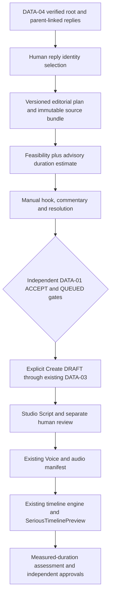

# DATA-05 — Verified conversation to editorial DRAFT

Base: faeb9b4; dedicated worktree Tiktok_Automation_data05 / codex/data05-editorial-production.

## Recovery audit

- DATA-04 exact target/relationship verifier and atomic conversation store reused unchanged. Public Schema.org parent evidence availability remains unverified LIVE.
- DATA-03 production consumer already enforces DATA-01 ACCEPT + QUEUED + confirmed identity + revision. Its adapter currently projects one root into one scene; extend this adapter, never bypass its gates.
- Studio has immutable originalText, separate display/spoken text, revision/locks, and matching audio cache invalidation.
- Existing buildVideoTimeline is the sole frame authority. Studio preview currently uses explicit silent placeholders when audio is absent; those cannot prove measured duration.
- Existing Kokoro/FFprobe manifests provide actual audio duration. No TTS/render/live collection runs in this task without further approval.
- Production baseline: 933/933 files unchanged, readable, manifest SHA-256 4897b40301b9452182147d1ea35d5c91c9867ffa47701d525f6ef65e890227e8. Runtime manifests remain Git-ignored.

## LIVE-01 gate

BLOCKED_TARGET / BLOCKED_APPROVAL. No target URL supplied; no automatic selection or LIVE call. Existing strict parent evidence standard is unchanged. Future pilot: one explicit target, <=20 verified replies, one browser, isolated store, no retry/cron/approval/production. Missing public relationship evidence means PARTIAL/BLOCKED.

## DATA-05A

Versioned deterministic feasibility separates material, substantive verified replies, structure and manually authored commentary. Popularity never overrides insufficient discussion. Missing hook/commentary/resolution stays visible; planner will not invent it. Duration uses an ESTIMATED 160–220 Vietnamese whitespace-token/minute advisory interval only. READY_FOR_SCRIPT is a planning recommendation, never measured-duration or factual approval. FUNNY remains disabled.

Boundary contract tests cover 59/60/61s, fixture versus measured, and padding that cannot compensate for insufficient narration. Release readiness always false in the duration-only assessment; independent human/content/audio/rights gates still apply.

## Checkpoint status (final offline acceptance, 2026-11-05)

| Checkpoint | Result | Evidence / limitation |
| --- | --- | --- |
| Recovery / isolated worktree | PASS | Based on faeb9b4; original branches/stores preserved |
| DATA-04 LIVE-01 | BLOCKED | No user-selected target or separate LIVE approval; zero LIVE runs |
| DATA-05A feasibility | PASS OFFLINE | Advisory, versioned deterministic evaluation; no accuracy claim |
| DATA-05B editorial planner | PASS OFFLINE | Explicit selection; manual original sections; immutable quote sources |
| DATA-05C timing contract | PASS OFFLINE | FFprobe tone fixtures 81s, existing timeline 83.5s / 2505 frames at 30 FPS |
| Real meaningful narration >60s | NOT_MEASURED | No real TTS or speech activity/semantic assessment performed |
| DATA-05D DATA-03 handoff | PASS OFFLINE | Actual atomic persistence/services; idempotency, stale revisions and recovery |
| DATA-05E Studio | PASS OFFLINE | 14/14 browser checks, actual local API/Player/upload/playback |
| Publishing / release readiness | BLOCKED | Rights UNKNOWN; no automatic script/audio/production approval |

PASS OFFLINE does not mean PASS LIVE. The original DATA-04 remains READY_FOR_LIVE; the new wrapper adds target/approval/resource gates and has only been exercised at its negative gate.

## DATA-05B/D — Planner and DATA-03 extension

Deterministic planner stores a hash-pinned immutable source bundle, ordered verified reply IDs, source/parent/permalink references and independent editorial selection. Quotes cannot be changed without PARAPHRASE labeling. Hook/commentary/resolution remain empty until manually written. Per-section locks and plan revision conflicts are enforced. Human quality labels remain separate from original heuristic scores. Missing quality returns UNKNOWN.

The existing ProductionConsumer now accepts a server-validated optional editorial snapshot. DATA-01 ACCEPT + QUEUED + confirmed POST, current Bronze body/identity, revision and explicit draft creation remain mandatory. Existing root-only behavior is preserved; a second job for the same queued source is blocked. Resume revalidates the pinned plan/selection and never overwrites an existing session. Script/audio/rights are not auto-approved. Targeted actual Studio/atomic store tests: 17 DATA05 + 10 DATA03 tests PASS.

Manual script approval is a separate operation and becomes STALE when script content changes. Voice and rights remain independent. DATA05 FINAL validation requires actual measured narration/timeline >60s plus script review; fixture duration cannot satisfy FINAL.

## DATA-05C — Duration evidence

Generated local synthetic tone WAV fixtures (not speech, no TTS): FFprobe durations 14, 18, 16, 25 and 8 seconds; total 81 seconds. Marked SYNTHETIC_FIXTURE in voice manifests and FIXTURE in AudioAssets. They test timing contracts only and cannot establish meaningful narration or LIVE TTS success. Muted/trimmed voice does not count its full manifest duration. Before TTS the estimate stays advisory; a duration-only pass never grants releaseReady.

LIVE pilot CLI has an absent-target/approval/resource gate, one explicit canonical target, isolated store and no retry. Running it without a URL returned BLOCKED_TARGET / exit 2 without collection. It has not run LIVE.

## Actual architecture

No new database, renderer, model or dependency. Atomic DataStore adds only the `editorial-plans` namespace. Source bundles retain root/reply IDs, parent IDs, canonical permalinks, original text, provenance, selected order, selection revision and hash. No DOM-order/author/proximity evidence is accepted as a parent relationship.

### Feasibility limitations

- Config: `EDITORIAL_CONFIG` (`feasibility/1`) in `editorial-feasibility.ts`; immutable report contains version/config hash and breakdown. Scoring is a material/structure proxy, not semantic understanding or a probability.
- Before TTS, estimate uses 160–220 whitespace tokens/minute scaled by each scene's configured reading speed (SERIOUS default 1.2). This cannot authorize duration or release.
- Missing verified substantive replies, tiny material or reaction-only discussion cannot be repaired by popularity. Uncertain quality stays UNKNOWN/review. Repeated prose cannot manufacture readiness.
- The planner copies verified quotes and creates empty original sections. It does not fabricate a hook, events or statements; a human supplies the analytical narration. Paraphrases must be explicitly labeled.
- After TTS, duration uses the saved existing timeline and matching measured audio manifests, excludes muted/trimmed voice and music, and requires both timeline and narration strictly greater than 60s, with narration coverage at least 75%. Unusual speed requires review. Above 100s is an advisory edit warning.
- Fixture timing passes only `FIXTURE_CONTRACT_PASS`; it cannot satisfy FINAL. Manifest length is not meaningful speech activity. Silence, semantic drift, source rights and editorial quality still require audition/review. No claim about TikTok monetization eligibility is made.

### Independent state and persistence

Reply quality feedback, selected replies, DATA-01 review/queue, editorial plan, script approval, spoken-text approval, audio approval and rights remain separate. Script changes invalidate its approval hash; voice settings invalidate only the corresponding audio, not script approval. Existing stale-audio/cache machinery is reused; files are not deleted.

Plans are revisioned snapshots. Creating a project pins its plan/source bundle; later plan edits never silently overwrite that project. Continue editing the created project in Script. Changing reply selection requires a new verified plan; there is no automatic rebase. DATA-03 refuses a second distinct project job for the same queued source; resume revalidates snapshots and returns the existing project.

FUNNY is reserved in the serializable contract but rejected by the executable planner/handoff. SERIOUS alone is enabled.

## Backend API for humans and agents

Prefix: `/api/studio/data/editorial`. Existing loopback/origin checks apply. GET operations never create jobs.

| Method / suffix | Operation / gates |
| --- | --- |
| GET `/plans` | List persisted plans |
| GET `/plans/:id` | Read exact saved plan, source bundle and feasibility |
| POST `/plans` | Create with collectionId, selectionRevision, requestId, style SERIOUS and selectionConfirmed=true |
| POST `/plans/:id` | Save sections with current plan revision; originals/references immutable; locks honored |
| POST `/plans/:id/project` | Current plan revision, DATA-01 source revision, requestId and confirmDraftCreation=true; consumer rechecks ACCEPT/QUEUED/identity/snapshot |
| GET `/sessions/:id/duration` | Saved-script estimates, matching measured/fixture evidence and separate script status |
| POST `/sessions/:id/approve-script` | Current session revision, confirmUserReview=true and reason; never approves audio or rights |

Request shapes and authoritative validation live in `editorial-engine.ts`, `editorial.controller.ts` and `production-consumer.ts`. Existing DATA-03 list/progress/history/resume APIs remain authoritative; no duplicate consumer API was introduced. The handoff avoids reentering Studio's nonreentrant lock; an actual-service regression verifies completion.

## Studio integration

Conversation review embeds the editorial panel, source originals, quote/paraphrase labels, manual text editing, locks, ordering, feasibility reasons, copy/export report and explicit Create DRAFT → Script. Script shows source roles, editable narration/display, advisory versus measured duration, and independent review. Existing Voice, media, global background, Editor and Player are reused. Original commentary is visibly labeled as editorial, never attributed to the Threads author; it uses the same pagination helper. SYNTHETIC/REAL/UNKNOWN labels use pinned provenance rather than defaulting to REAL.

Current isolated demo (test content and tones, not a real video):

`http://127.0.0.1:3103/studio?session=839c6dfc-aca1-5aaf-843b-14a2b378c0c8&area=Video%20Studio&step=Video%20Editor`

The server stays on loopback. It runs from a newly created external acceptance directory, strips credential environment variables, blocks external HTTP and inference/render/publish operations, and never writes production storage. Runtime store paths are recorded in Git-ignored isolation manifests. Its test-only tone injection route is in the harness, not the application controller. Test runtime is BLOCKED_RUNTIME, not a fake Kokoro READY.

Reproduce sequentially, from this dedicated worktree:

1. Backend build, then `node test/data05-audio-fixtures.cjs` under `1_nest_backend` (local PCM generation and FFprobe only).
2. `npm run studio:build` under `2_Remotion_Video`.
3. `node test/data05-runtime.cjs` under backend; it creates a fresh isolated store on port 3103.
4. `node test/data05-browser.cjs` under backend; synthetic review/queue/project actions are explicit test inputs. Do not point this harness at production.
5. Stop only that owned runtime with Ctrl+C when finished. There is no Windows auto-start or cron.

Future LIVE pilot: supply one user-approved canonical permalink to `scripts/data05-live-pilot.cjs`, with separate `--confirm-approved-one-run` and process-local `STUDIO_DATA04_LIVE_ENABLED=1`. Do not set the flag globally. The script refuses absent target/approval, checks available RAM, creates a fresh pilot store and retains DATA-04 budgets. No LIVE command has been executed in this task. Missing trustworthy parent evidence must remain PARTIAL/BLOCKED, never guessed.

## Verification evidence

All builds/tests ran sequentially, using installed dependencies/browser. Exit code 0 unless specified:

| Check | Actual result |
| --- | --- |
| Backend TypeScript (`tsc --noEmit`) | PASS |
| Frontend TypeScript (`tsc --noEmit`) | PASS |
| Backend build | PASS |
| Studio frontend bundle | PASS |
| Remotion bundle | PASS; separate from rendering |
| Full Jest offline | 41 suites / 263 tests PASS; 74.63s |
| Browser isolated E2E | 14/14 PASS; existing Chrome, real Nest/API/atomic store/React/Player |
| Local fixtures FFprobe | 14 + 18 + 16 + 25 + 8 = 81s, PCM mono 16kHz; not narration |
| Fixture Player timeline | 83.5s / 2505 frames at 30 FPS, five scenes |
| Target-less LIVE CLI | Exit 2, BLOCKED_TARGET, no collection |
| Production preservation | 933/933 unchanged, zero unreadable/locked files in scope |
| Git diff whitespace | PASS (`git diff --check`); Windows line-ending notices only |

Browser evidence (Git-ignored, never committed): `1_nest_backend/.studio-data/reports/data05/browser-1793891653493/` contains `report.json`, `editorial-plan.png`, `editorial-preview.png`. `browser-latest.json` points there. Jest output: `.studio-data/reports/data05/jest-verified.log`. No source data is represented as real in these artifacts.

Browser checks cover no side effects on opening, verified selection, manual content and immutable quote, plan reopen, independent synthetic DATA-01 approval/queue, one DATA-03 DRAFT, Script/Voice navigation, actual fixture playback clock advancement, exact seek starts across five scenes, editorial attribution, valid PNG upload/background/save/reopen, source integrity, text/settings staleness and no external/production calls. These do not prove live speech intelligibility, word-level subtitle sync, real collection success or MP4 fidelity.

Regression cases include wrong/missing/nested parent, same author/different posts via retained DATA-04 tests; 59/60/61s boundaries; stale revisions; duplicate handoff/retry/restart; locks; quote/paraphrase protection; emoji/insufficient/uncertain material; repetition; fixture-vs-measured; muted/trimmed narration; Gold/data/session preservation. A test request initially used the Script save endpoint for voice settings; corrected it to the existing SETTINGS API rather than broadening the backend contract.

RAM available sampled before browser 558 MiB, during preview 625 MiB, after closing browser 911 MiB; browser harness Node RSS 51/66/71 MiB. These are samples, not aggregate browser/process peak or a performance benchmark. No OOM observed. No new model or dependency downloaded.

Preservation manifest before/after SHA-256:

`4897b40301b9452182147d1ea35d5c91c9867ffa47701d525f6ef65e890227e8`

Run `node test/data05-preservation.cjs` for read-only verification. Original session `35b8a880-b8b5-49ec-be42-0991228eb45e` remains in production, not used as a writable acceptance fixture.

## Source changes and checkpoints

- New `src/data-engine/editorial-*`: contracts, feasibility, planner/store adapter, DATA-03 projection, script hash, API and synthetic tests.
- Existing DATA-03 consumer/contracts/adapters, DataStore namespace, Studio service/module/contracts, preview builder, voice duration evidence and FINAL policy: compatible optional editorial extensions.
- Frontend `EditorialPanel`, `EditorialDurationPanel`, Conversation/Script integration, provenance adapter and existing composition's commentary/pagination handling.
- Local-only fixture/runtime/browser/preservation harnesses and gated future LIVE script; no runtime files tracked.
- Checkpoints pushed: `19f9647` (feasibility/duration foundation), `da58153` (planner/guarded DATA-03 handoff). Final Studio/regression checkpoint SHA is reported in the conversation after committing this document.

## Remaining gates

1. User chooses one public permalink and separately approves the bounded isolated LIVE pilot.
2. Confirm actual root/reply relationships and collection completeness; otherwise stop PARTIAL/BLOCKED.
3. User selects source replies and writes/reviews original analysis; heuristic quality accuracy remains NOT_MEASURED without human labels.
4. Separately authorized real TTS and audition, then measured meaningful narration/timeline >60s (internal target 70–100s), keeping DRAFT and independent approvals.
5. Source/media rights remain UNKNOWN until evidenced. No automatic publishing, scheduler, release approval or monetization claim.
